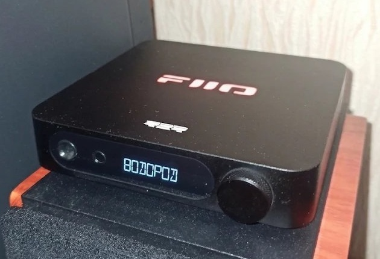
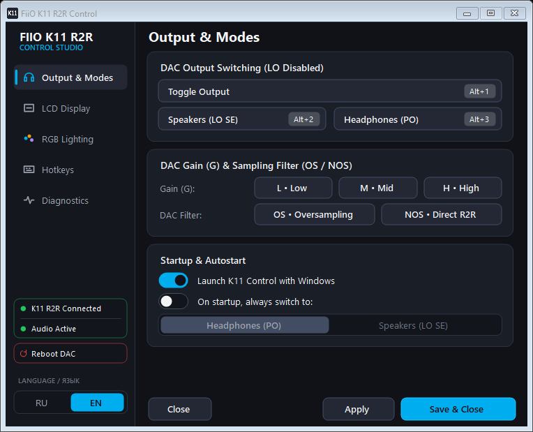
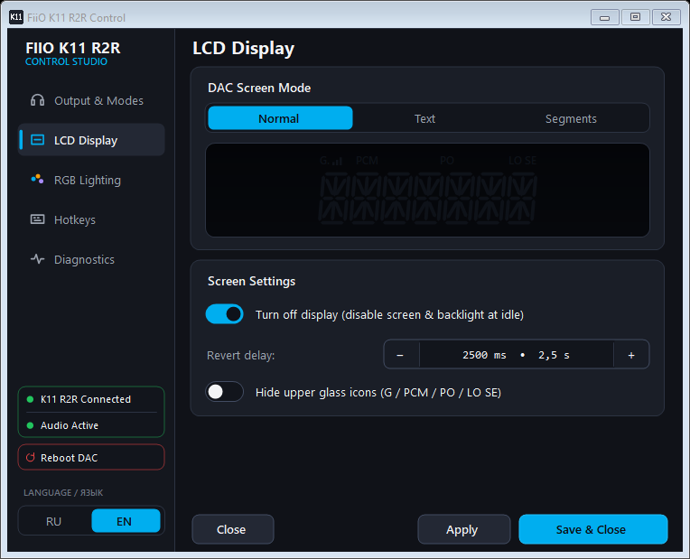
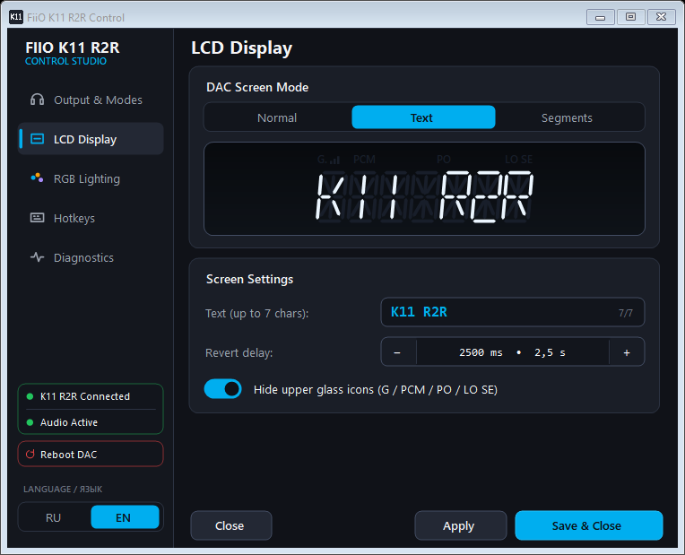
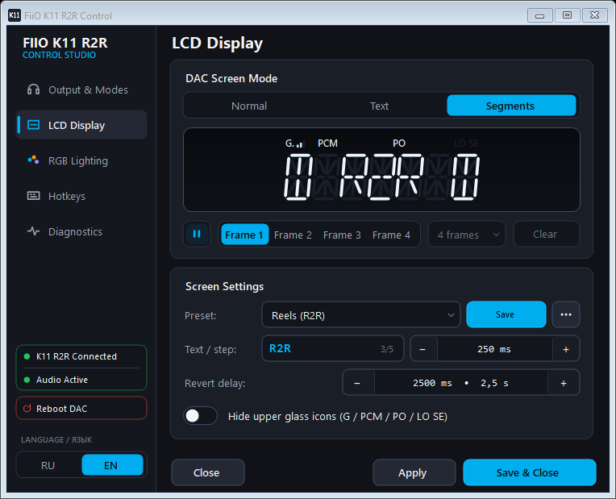
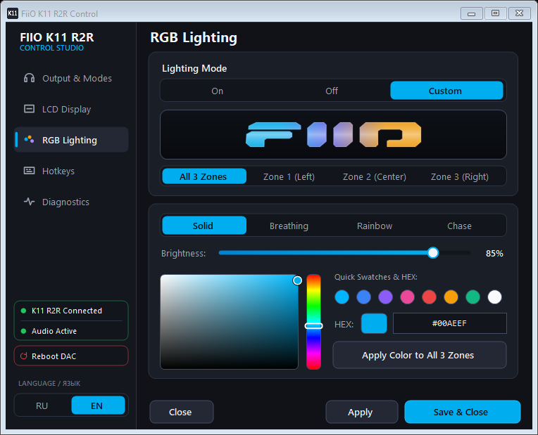
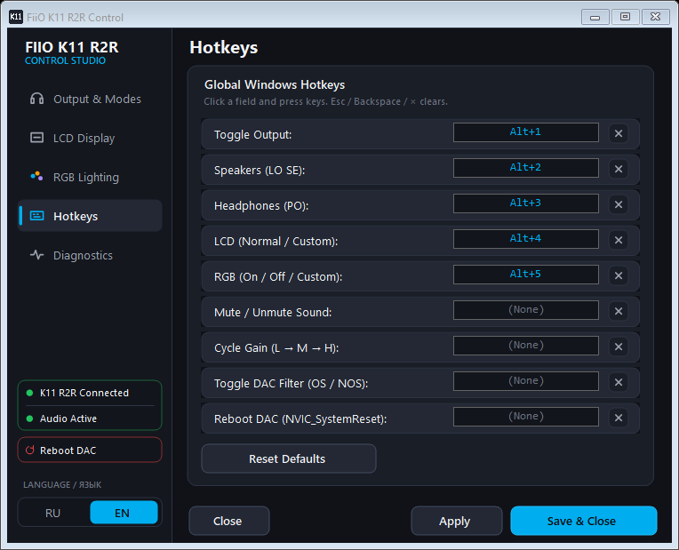

# FiiO K11 R2R Control

**English** | [Русский](README.ru.md)

Windows system tray control app and patched `M79` firmware for the **FiiO K11 R2R** DAC/Amp — switch outputs safely, customize the 14-segment LCD and 3-zone RGB lighting over USB, and bind global hotkeys with zero hardware mods and zero writes to MCU Flash.

<p align="center">
  <br />
  <sub>Custom Cyrillic LCD text (<b>ВОДОРОД</b>, hidden status icons) and custom red <b>FIIO</b> RGB controlled via USB</sub>
</p>

---

## Features

- **Safe Output Switching (`PO ↔ LO SE`, `LO` Disabled):** removes fixed max-volume `LO` from both the hardware knob double-press and `OUT` menu; gives direct `Toggle`, `Headphones (PO)`, and `Speakers (LO SE)` commands without altering your active output on startup unless enabled.
- **Gain (`L / M / H`) & DAC Filter (`OS / NOS`):** switch gain and oversampling modes directly from the UI, tray menu, or hotkeys.
- **Custom LCD Display (3 Modes):**
  - **Normal:** stock display, optional hiding of upper status icons (`G / PCM / PO / LO SE`), or **Turn off display** (disables screen & backlight at idle, wakes on knob/menu activity with configurable upper icons).
  - **Text:** display up to 7 custom characters at idle (Latin + Cyrillic 14-segment font) with configurable revert delay (`500–30000 ms`).
  - **Segments:** interactive 14-segment editor with `1–4` frame animations, `7` built-in templates (`Reels`, `Brackets`, `Impulse`, `Pulse EKG`, `Orbit`, `Rain`, `Singing`), and custom presets.
- **3-Zone RGB Lighting:** `On` (stock), `Off`, or `Custom` (`Solid`, `Breathing`, `Rainbow`, `Chase`), brightness control, HSV picker, and independent colors for all 3 logo zones.
- **Global Hotkeys, Mute & Software Reboot:** customizable Windows shortcuts (`Alt+1`..`Alt+5` defaults), CoreAudio mute, and `Reboot DAC` without unplugging USB.
- **RAM-Only DAC Updates:** all settings are stored in a local JSON config on PC and synced into DAC RAM on launch/USB connect.

---

## Screenshots

<table>
  <tr>
    <td align="center" width="33%">
      <br />
      <sub><b>Output &amp; Modes</b></sub>
    </td>
    <td align="center" width="33%">
      <br />
      <sub><b>LCD: Turn Off Display</b></sub>
    </td>
    <td align="center" width="33%">
      <br />
      <sub><b>LCD: Custom Text</b></sub>
    </td>
  </tr>
  <tr>
    <td align="center" width="33%">
      <br />
      <sub><b>LCD: Segments &amp; Animation</b></sub>
    </td>
    <td align="center" width="33%">
      <br />
      <sub><b>RGB Lighting (3 Zones)</b></sub>
    </td>
    <td align="center" width="33%">
      <br />
      <sub><b>Global Hotkeys</b></sub>
    </td>
  </tr>
</table>

---

## Quick Start

1. Download the standalone archive from **Releases** (`FiiO-K11-R2R-Control-v*-win-x64.zip` — `K11Control.exe` is self-contained and does not require installing `.NET Runtime`).
2. Download the official **M79 firmware package** from FiiO (it includes `GD32_MCU_HID_IAP_Programmer.exe` and the stock `k11R2R_app1_m79.hex` for rollback; proprietary vendor files are not stored in this repository).
3. On the K11 R2R menu, select **`UPDATE → Y`**, open `GD32_MCU_HID_IAP_Programmer.exe`, and flash **`k11R2R_m79_full.hex`**.
4. Launch **`K11Control.exe`** — it runs quietly in the Windows system tray.

> **Rollback:** restore stock firmware anytime by flashing FiiO's original **`k11R2R_app1_m79.hex`** with the same programmer.

---

## Build from Source

Requires **Python 3.12+** and **.NET 8 SDK** (`net8.0-windows`). Place FiiO's stock `k11R2R_app1_m79.hex` into `firmware/official/K11 R2R M79 Firmware/` (or pass `-OfficialDir <path>`), then run:

```powershell
# Build standalone K11Control.exe + patched HEX files into dist\ and run all tests
powershell -ExecutionPolicy Bypass -File scripts\build_dist.ps1 -IncludeTests

# Also package a clean GitHub Release ZIP into release\
powershell -ExecutionPolicy Bypass -File scripts\build_dist.ps1 -Release -IncludeTests
```

---

## Internals & License

- USB transport protocol, hardware safety rules, and `M79` memory map are documented in [AGENTS.md](AGENTS.md).
- Released under the [MIT License](LICENSE).
