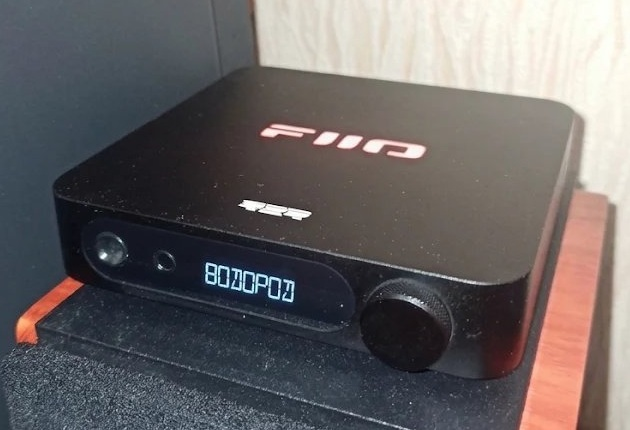
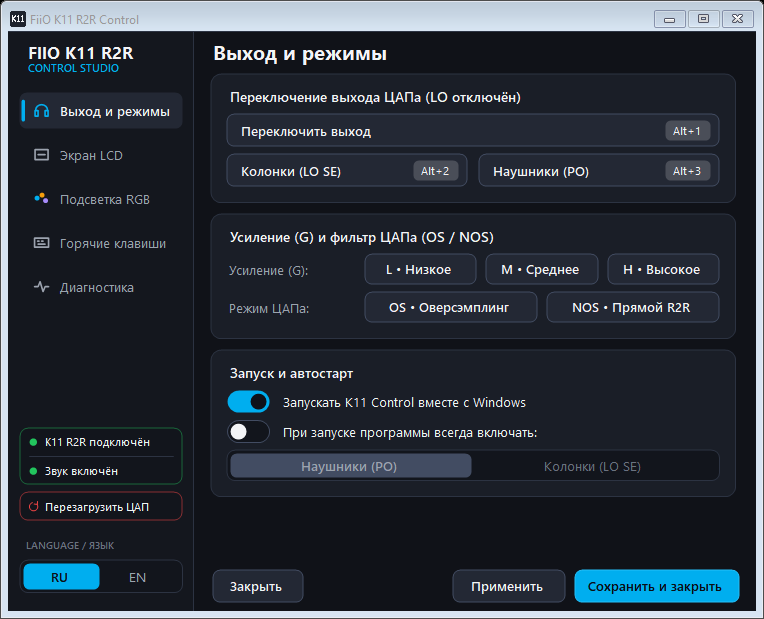
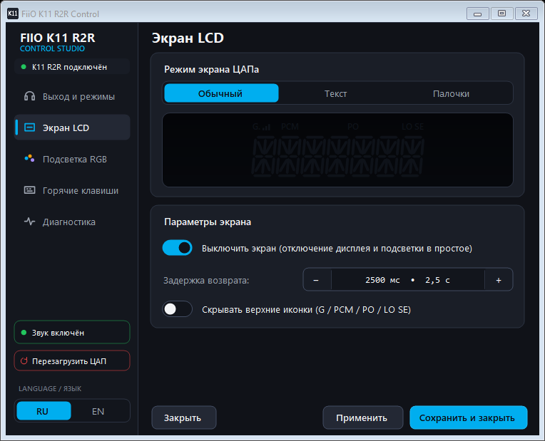
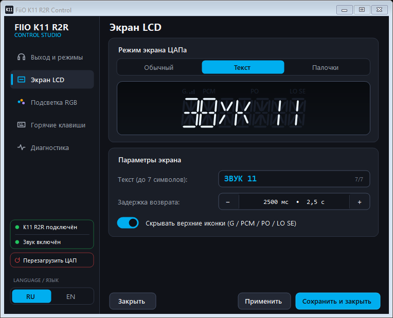
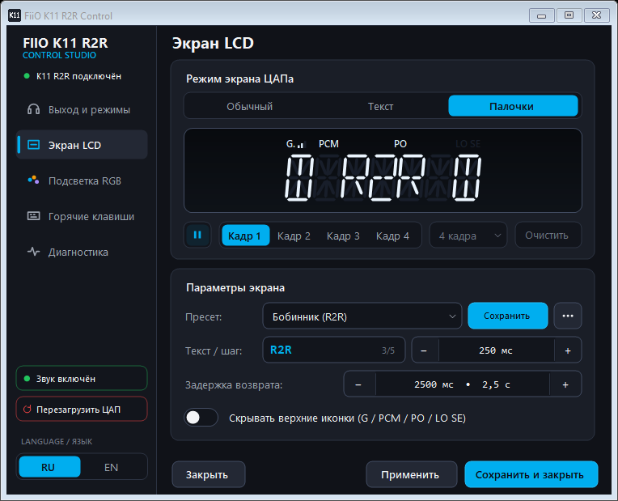
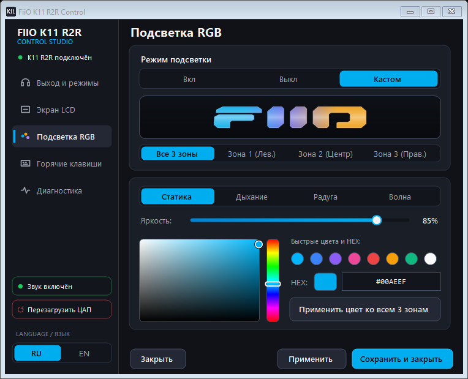
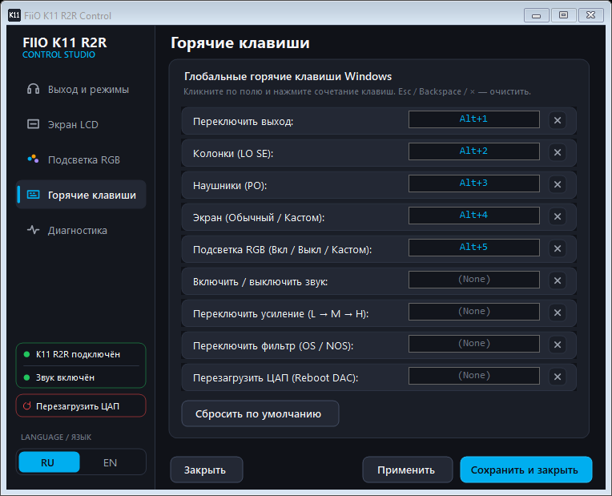

# FiiO K11 R2R Control

[English](README.md) | **Русский**

Приложение в системном трее Windows и патч прошивки `M79` для ЦАП/усилителя **FiiO K11 R2R** — безопасное переключение выходов, настройка 14-сегментного LCD-экрана и 3-зонной RGB-подсветки по USB и глобальные горячие клавиши без аппаратного вмешательства и без записи настроек во Flash ЦАПа.

<p align="center">
  <br />
  <sub>Кастомный текст на кириллице (<b>ВОДОРОД</b>, верхние иконки скрыты) и красная RGB-подсветка <b>FIIO</b> по USB</sub>
</p>

---

## Возможности

- **Безопасное переключение выхода (`PO ↔ LO SE`, без `LO`):** нерегулируемый линейный выход `LO` (100% громкости) убран и с двойного клика ручки, и из меню `OUT`; прямое переключение `Toggle`, `Наушники (PO)` и `Колонки (LO SE)` не трогает текущий выход при запуске, если не включена соответствующая опция.
- **Усиление (`L / M / H`) и фильтр (`OS / NOS`):** быстрое переключение из окна настроек, меню трея и с горячих клавиш.
- **Кастомный LCD-экран (3 режима):**
  - **Обычный:** штатная индикация, отдельное скрытие верхних иконок (`G / PCM / PO / LO SE`) либо режим **«Выключить экран»** (отключает дисплей и подсветку в простое, с временным пробуждением при повороте ручки или нажатии меню и выбором показа верхних иконок при пробуждении).
  - **Текст:** вывод до 7 символов в простое (латиница + кириллица на 14 сегментах) с настройкой задержки возврата (`500–30000 мс`).
  - **Палочки:** попиксельный 14-сегментный редактор, анимации из `1–4` кадров, `7` встроенных пресетов («Бобинник», «Скобки», «Импульс», «Пульс», «Орбита», «Дождь», «Поёт») и свои пользовательские пресеты.
- **3-зонная RGB-подсветка:** режимы **Вкл** (штатная), **Выкл** и **Кастом** (`Статика`, `Дыхание`, `Радуга`, `Волна`), яркость, HSV-палитра и раздельный цвет для каждой из 3 зон логотипа.
- **Горячие клавиши, `Mute` и перезагрузка ЦАП:** глобальные хоткеи Windows (`Alt+1`..`Alt+5` по умолчанию), управление системным `Mute` и программный сброс без выдёргивания кабеля.
- **Настройки только в RAM ЦАПа:** конфигурация хранится в JSON на ПК и применяется в RAM при запуске и подключении по USB.

---

## Скриншоты

<table>
  <tr>
    <td align="center" width="33%">
      <br />
      <sub><b>Выход и режимы</b></sub>
    </td>
    <td align="center" width="33%">
      <br />
      <sub><b>LCD: Выключить экран</b></sub>
    </td>
    <td align="center" width="33%">
      <br />
      <sub><b>LCD: Свой текст</b></sub>
    </td>
  </tr>
  <tr>
    <td align="center" width="33%">
      <br />
      <sub><b>LCD: Палочки и анимация</b></sub>
    </td>
    <td align="center" width="33%">
      <br />
      <sub><b>Подсветка RGB (3 зоны)</b></sub>
    </td>
    <td align="center" width="33%">
      <br />
      <sub><b>Горячие клавиши</b></sub>
    </td>
  </tr>
</table>

---

## Установка и инструкция по перепрошивке

### 1. Подготовка файлов (Windows 10 / 11)
1. Скачайте **`FiiO-K11-R2R-Control-v*-win-x64.zip`** из раздела **Releases**:
   - **`k11R2R_m79_full.hex`** *(рекомендуется)* — полная прошивка для управления из `K11Control.exe` + отключение `LO`.
   - **`k11R2R_m79_no-lo.hex`** — облегчённый патч (только отключение `LO` и фикс USB, если не планируете пользоваться программой в трее).
   - **`K11Control.exe`** — автономная программа в трей (`self-contained`, установка `.NET Runtime` не требуется).
2. Скачайте [официальный пакет прошивки M79 от FiiO](https://forum.fiio.com/note/showNoteId.html?id=202507021516543188544) — внутри лежат прошивальщик **`GD32_MCU_HID_IAP_Programmer.exe`** и заводская прошивка **`k11R2R_app1_m79.hex`** (на случай отката).

### 2. Порядок прошивки
Подключите K11 R2R напрямую к USB-порту ПК (не отключайте кабель и питание до окончания процесса):
1. Включите ЦАП и **удерживайте ручку громкости (~2 сек.)**, чтобы войти в меню.
2. Поворотом выберите **`UPDATE`** → коротко нажмите ручку → выберите **`Y`** → коротко нажмите для подтверждения. На экране появится **`RETURN`**.
3. Откройте **`GD32_MCU_HID_IAP_Programmer.exe`** и убедитесь, что в списке **`IAP Device`** отображается **`GD32 USB IAP in FS Mode`**.
4. Нажмите **`open`** (в блоке *Download APP program file*) и выберите **`k11R2R_m79_full.hex`**.
5. Нажмите **`OK`**, дождитесь окна **`Download successfully!`**, подтвердите его и закройте программу кнопкой **`Cancel`** *(не нажимайте `OK` повторно и не нажимайте `Leave IAP`)*.
6. На экране ЦАПа всё ещё горит **`RETURN`**: **коротко нажмите ручку** → выберите **`Y`** → коротко нажмите. ЦАП перезагрузится уже с новой прошивкой.
7. Запустите **`K11Control.exe`** (программа свернётся в системный трей).

> **Откат и восстановление:** чтобы в любой момент вернуться на заводскую прошивку, повторите шаги 2–6 с оригинальным **`k11R2R_app1_m79.hex`**. Загрузчик ЦАПа (`< 0x08008000`) при прошивке не затрагивается — если процесс прервётся, достаточно выключить/включить питание, снова зайти в **`UPDATE → Y`** и прошить повторно.

---

## Сборка из исходников

Требуются **Python 3.12+** и **.NET 8 SDK** (`net8.0-windows`). Положите официальный `k11R2R_app1_m79.hex` в папку `firmware/official/K11 R2R M79 Firmware/` (или передайте `-OfficialDir <путь>`):

```powershell
# Сборка standalone K11Control.exe + пропатченных .hex в dist\ и прогон всех тестов
powershell -ExecutionPolicy Bypass -File scripts\build_dist.ps1 -IncludeTests

# Плюс упаковка чистого ZIP-архива для GitHub Releases в release\
powershell -ExecutionPolicy Bypass -File scripts\build_dist.ps1 -Release -IncludeTests
```

---

## Технические детали и лицензия

- Карта адресов прошивки `M79`, протокол передачи поверх UAC2 и правила аппаратной безопасности вынесены в [AGENTS.md](AGENTS.md).
- Код проекта распространяется под лицензией [MIT](LICENSE).
